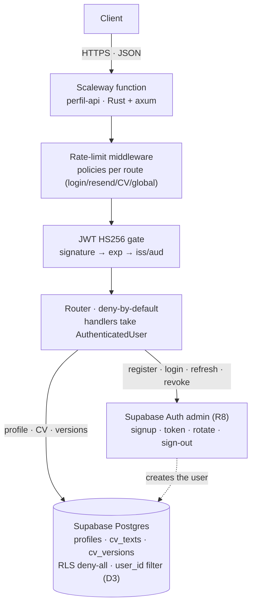
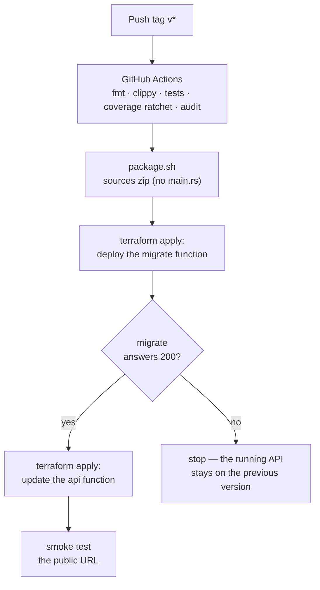

# Professional Profile API — serverless beta

REST API for a professional profile (registration, auth, text-based CV, versions) built in **Rust** and deployed as a **serverless function** on Scaleway, with **Supabase** as identity and database provider.

> ⚠️ **This product was created 100% by AI** (Claude Code). The human role was product-owner: posed the problem, defined the working rules, steered the decisions and reviewed every PR. Every merge is a human review of the agent's proposed work.

## The goal of the experiment

This is not a SaaS launch: it is a way-of-working validation. Three questions on the table:

1. **SDD in practice.** Pose a problem and solve it with Spec-Driven Development (speckit): from conversation to specification (constitution → spec → plan → tasks), and build only what the spec asks for. The measurable value: does the final result match what the specification describes?
2. **CI/CD on Scaleway, first time.** Serverless function deployed with Terraform + GitHub Actions (deploy to production only, by tag — D16), with a pipeline enforcing fmt/lint/tests/coverage-with-ratchet/audit/Terraform-plan before merge.
3. **Supabase, first time.** Auth (JWT, refresh-token rotation), Postgres with deny-all RLS and tenancy isolation in code, in the model of an API with no front-end of its own.

## Stack

| Layer | Choice |
|---|---|
| Language/framework | Rust · axum/tokio · sqlx (queries verified at compile time) |
| Function | Scaleway Functions (monolith in one function — ADR 0004) |
| Identity + DB | Supabase Auth (JWT HS256) · Supabase Postgres with deny-all RLS (A3/D3) |
| Infra | Terraform (`infra/`) · state in Scaleway Object Storage |
| Pipeline | GitHub Actions: fmt · clippy · tests · 90%+ coverage with ratchet (ADR 0016) · cargo audit · Terraform plan on PR |
| Quality | RFC 7807 errors (ADR 0009) · traceability events with a closed catalogue (ADR 0017) · an ADR for every decision (17 as of today) |

## Request flow of the first beta



The credential never reaches a handler unless the gate certifies it: the middleware resolves the identity (R1) and the repositories filter every query by `user_id` (FR-019) — the RLS of Supabase is the security net, the Rust filter is the authorized path.

## Deploy flow (R10 — migrate before api)



## SDD: the artifacts

The workflow of the project lives in the repo, in this order:

1. **Research and specification** — `docs/plan.md` and `specs/001-beta-profile-api/`: threat model with OWASP API Security Top 10 (2023), FR/NFR requirements, a decision matrix (D1–D16) with rationale, DB schema and a risk budget.
2. **Constitution** — `.specify/memory/` (the working rules the agent cannot negotiate).
3. **Plan and tasks** — stacked tasks T001…Tnnn, PRs of ≤6 files, manual review between stacks.
4. **ADRs** — `docs/adr/0001…0017`: mandatory email verification, no scopes in beta, monolith, CV in Postgres, axum, RFC 7807, trunk-based, deploy by tags, minimum coverage, event catalogue, hard-delete account erasure (minimum GDPR), LLM-era readiness.

## Timeline

| | |
|---|---|
| Started | October 20, 2026 (first commit) |
| Last updated | October 22, 2026 |
| Commits | 37 |
| Human time invested | *(manual log — to fill in)* |

All of the above — research, specification, ADRs, code, migrations, declarative infrastructure and pipeline — was produced during those directed sessions. *(Hour detail per task and the research performed is expanded in the project documentation, to be written.)*

## Current status

- ✅ Foundations: Rust workspace, specification, ADRs, green CI pipeline.
- ✅ T001–T010: config, canonical errors, Supabase Auth client, repositories with atomic transaction (optimistic locking), JWT HS256 + rate-limit middleware, integration harness and wiring of the 10 routes.
- 🚧 T011+: the flow handlers (register, login, refresh, revoke, profile, CV), the `migrate` handler (R10), smoke test and the first deploy by tag.

## How to run it

```bash
cargo test                          # unit + integration (skips without a local DB)
cargo fmt --check && cargo clippy --all-targets --all-features -- -D warnings
# Local DB for the repository tests:
# supabase start && DATABASE_URL=... cargo test
```

Migrations (R10): run with `sqlx` against the Supabase pooler in *session mode* (the direct connection requires IPv6; the session mode is the compatible path — `MIGRATIONS_DATABASE_URL` in `.env`). In production the pipeline deploys the `migrate` function and only updates `api` if it answers 200.

Deploy: tag `vX.Y.Z` → the pipeline packages the sources (`package.sh`), Terraform applies and smoke-tests. The function secrets live **out of the repo** (attached in Scaleway; never in GitHub).

## Documentation to come

The README covers the experiment. The technical documentation of the product (architecture, API contracts, the full threat matrix, operations runbook) comes after the first deploy — with the same SDD criterion as the rest of the repo.